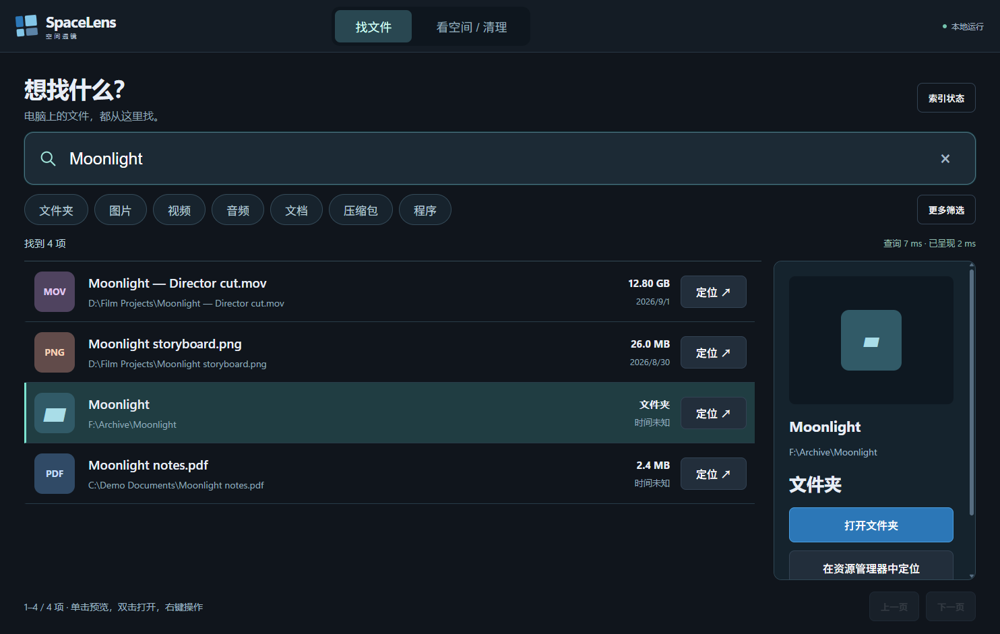
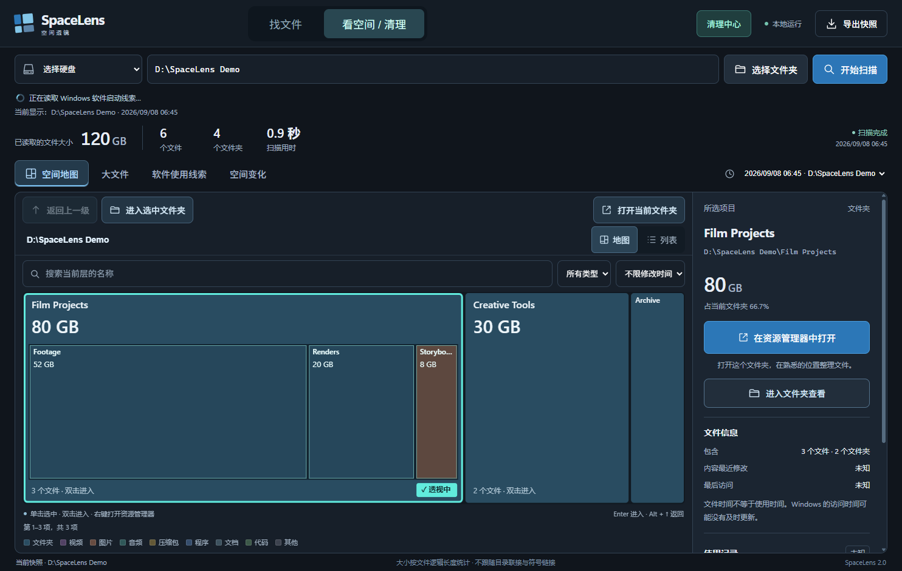

# SpaceLens · 空间透镜

**找文件，看空间，直接整理。** Portable Windows desktop app with Everything-powered instant search, a disk treemap, and reviewed cleanup. 中文大字号界面，支持 CLI / MCP。

## 下载

从 [Releases](https://github.com/JingDuuu/SpaceLens/releases) 下载 Windows x64 ZIP，**完整解压**到可写目录，双击 `SpaceLens.exe`。无需另装 Node 或 .NET。Windows 10/11 x64；其他架构未验证。



## 两个入口

**找文件**是默认首页：大搜索框、清晰的大字结果、类型标签点一下开启 / 再点取消。多种类型可以一起选择。支持磁盘范围、大小和修改时间排序、大小写、完整路径匹配、正则表达式，以及 Everything 的通配符和搜索语法。单击看大预览，双击打开，右键定位或复制路径。Ctrl+K / Ctrl+F 回到搜索框，F5 立即刷新。停留在搜索页时，结果自动跟随索引更新，并保留仍存在的选中项与滚动位置。

**看空间 / 清理**保留扫描进度、空间地图、大文件、软件使用线索、快照对比。单击文件夹，在原色块中透视内部一层；双击进入，Alt+↑ 返回。



## 搜索引擎与速度

便携包附带 voidtools 官方 **Everything 1.4.1.1032**。SpaceLens 通过常驻原生消息窗口直接使用 QUERY2 IPC；连续输入会取代旧查询，结果分页返回，图片预览在选择后异步读取。

- 首次运行自动建立本机索引；NTFS / ReFS 使用 Everything 实时索引，其他已连接磁盘使用目录索引和更新监视。
- 新电脑若没有 Everything 服务，在“索引状态”点击“启用索引服务”，完成一次 Windows 权限确认。桌面窗口保持普通权限。
- 不修改原有 Everything 用户配置，SpaceLens 使用自己的实例和 `data/search` 索引。桌面使用期间在后台保持文件名更新，退出桌面时关闭本实例并保存索引，减少后台占用；CLI 单独使用的索引可继续驻留。没有网络搜索服务器。
- **首次建索引不是即时的**，尤其是机械硬盘或网络盘。断开、无法访问、文件系统不支持的区域不能承诺完整覆盖。索引状态列出已连接的磁盘；目录索引更新速度取决于介质和权限。
- 在约 462 万项的一个本机样本中，5 种预热查询各运行 6 次，返回最多 80 项，平均查询耗时约 **15–28 ms**。该数字不包含首次索引和 65 ms 输入合并，不是所有电脑、所有查询的保证，也不是与 Everything 原生窗口的全面速度对测。界面显示本次查询实际耗时。
- 默认搜索文件名与路径。`content:` 等需要读取内容的语法不享有纯文件名索引速度。

## 清理流程

- **一键清理普通垃圾**：点击后检查并删除当前用户临时目录、Windows Temp、崩溃转储、DirectX 缓存中至少 7 天未变动的普通文件；跳过链接、硬链接、已变化和无法处理的文件。不需要逐类勾选，也不会清理个人文档、下载或安装目录。此类临时文件删除不进入回收站；旁边保留“检查可清理文件”用于先看明细。
- **大文件整理**：从全部已索引磁盘找出 ≥1 GB 文件，默认全部不选。选择后复核路径和文件身份，再确认移入回收站；失败不回退为永久删除。系统和应用数据目录受保护。可在回收站恢复；**清空回收站后才实际释放空间**。
- **应用整理**：按安装登记大小、最后可见启动记录筛选。点击“卸载应用”会重新读取登记并确认，直接运行应用的卸载程序或 MSI 卸载，不再跳转 Windows 应用列表。某些卸载程序仍会显示自己的窗口或 UAC。间接脚本 / 不支持的卸载入口会明确报出，应用自身的数据保留选项由卸载程序决定。

最后可见启动记录来自 UserAssist / 当前可见进程，可能缺失，**不能证明此后没用过**；未知记录单独显示。安装大小是估算值。清理可以释放空间，不能保证提高 CPU、GPU 或程序运行速度；本程序不做注册表“优化”、强制结束进程或关停启动项。

地图采用逻辑文件大小，稀疏、压缩和硬链接可能与物理占用不同；扫描问题和跳过项保留明细。

## CLI / MCP

```powershell
.\spacelens.cmd search-status
.\spacelens.cmd search --query "Moonlight" --type video --limit 50
.\spacelens.cmd search --query "*.png" --drive 'D:\' --sort modified
.\spacelens.cmd scan --path 'D:\'
.\spacelens.cmd children --id 0 --limit 50
.\spacelens.cmd cleanup
.\spacelens.cmd cleanup-apps --older-days 180 --min-bytes 1000000000
.\spacelens.cmd mcp-config
```

输出 JSON；清理 / 卸载执行只在桌面通过明确点击进行，CLI/MCP 只读查询。服务未启用或索引未准备完成时返回状态，不用空结果冒充成功。迁移后重新运行 `mcp-config` 更新路径。

`data/` 是本机快照、索引和清理汇总，**不进入 Git 或发布包**。索引按电脑区分。程序不上传文件数据；外部 AI 客户端能够看到用户请求它读取的结果。示例截图使用虚构数据。

## 开发与发布

需要 Windows x64、Node.js 24.20+、.NET 9 SDK。

```powershell
npm ci
npm test
npm run start
npm run release
```

`build` 输出 `dist/SpaceLens`，`release` 额外生成 ZIP / SHA-256。已有输出目录时先移走旧包，也可指定 `node scripts/build.cjs --out SpaceLens-test`。构建下载 Everything 官方归档并检查固定哈希。推送 `v*` 标签后 GitHub Actions 测试、构建并发布 Release。

应用源码 MIT 开源；Everything 等上游运行时按各自许可证分发，见 [第三方声明](THIRD_PARTY_NOTICES.md) 和 [架构与维护](docs/OPEN_SOURCE.md)。SpaceLens 与 voidtools / SpaceSniffer 没有隶属关系。
